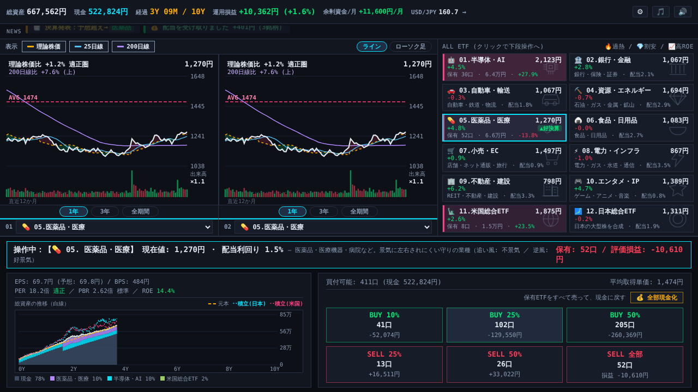
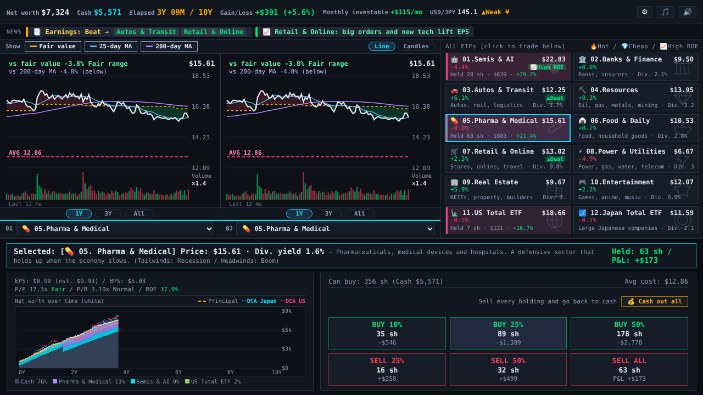

# SECTOR TRADER

10年間で、12本のETF（10業種＋日本総合・米国総合）を売買し、同じお金を毎月積み立てた場合（積立）と、最終的な資産を比べて評価される、ブラウザ向けの投資シミュレーションゲームです。

## 遊ぶ
[URL]

- ジャンル: 投資シミュレーション（1プレイ約4分）
- 対応: PCブラウザ（スマホは未対応。画面は1280×720基準で拡大縮小）
- 言語: 日本語 / English　通貨: 円 / ドル
- 音が出ます。BGMと効果音の音量は、右上の🎵から別々に調整できます。

## 遊び方
- 毎月の余剰資金（給与 − 生活費）が、現金に加わります。
- ニュースや決算に注目して、ETFを買う・売るを繰り返します。
- 生活費を払えなくなると、保有ETFが自動で売られます。それでも足りなければ破産です。
- 10年後の総資産が、積立（日本・米国）と比べてどうだったかで、ランクが決まります。
- 難易度は、ノーマルとハードから選べます。

## 特徴
- 10業種＋日本・米国の総合ETFの、合計12本を売買できます。
- 理論株価・25日線・200日線を表示でき、ライン／ローソク足を切り替えられます。
- 暴落シナリオ（バブル崩壊・金融危機・パンデミックなど）が、ランダムに起こります。

## 免責事項
本ゲームは完全なフィクションです。実在の金融商品・企業とは関係なく、投資の推奨や助言ではありません。過去の市場の出来事に着想を得た演出を含みますが、数値や展開は実際のものではありません。現実の投資判断はご自身の責任で行ってください。全文はゲーム内のスタート画面にあります。

## データの扱い
個人情報は収集しません。設定（言語・通貨・音量など）と自己ベストのみ、お使いのブラウザに保存されます。そのため、別の端末やブラウザには引き継がれません。

## ライセンス・利用について
© 2026 bono. All rights reserved.

無断での転載・再配布・改変しての公開はお断りします。

プレイ動画の投稿・配信は自由です。
 
 
 
# English

A browser-based investment simulation game. Over 10 in-game years, you trade 12 ETFs (10 sectors plus Japan Total and US Total) and are scored against a simple monthly-DCA benchmark.

## Play
[URL]

- PC browsers only (not for phones). The game has sound; adjust music and sound effects separately from the 🎵 button.
- Languages: Japanese / English. Currencies: yen / dollar.

## How to play
- Your monthly surplus (salary minus living costs) is added to your cash.
- Watch the news and earnings, and buy and sell ETFs.
- If you cannot pay your living costs, holdings are sold automatically. If that is not enough, you go bankrupt.
- After 10 years, your net worth is compared with monthly DCA into Japan and US ETFs to determine your rank.

## Disclaimer
This game is entirely fictional. It has no connection to any real financial product or company, and it is not investment advice. Some scenarios draw inspiration from past market events, but the numbers and developments are not real. Please make real investment decisions at your own responsibility. The full text is on the game's start screen.

## Data
No personal information is collected. Only your settings (language, currency, volume, etc.) and your personal best are saved in your own browser, so they do not carry over to other devices or browsers.

## License
© 2026 bono. All rights reserved.

Please do not republish, redistribute or modify and publish this game. Gameplay videos and streams are welcome.